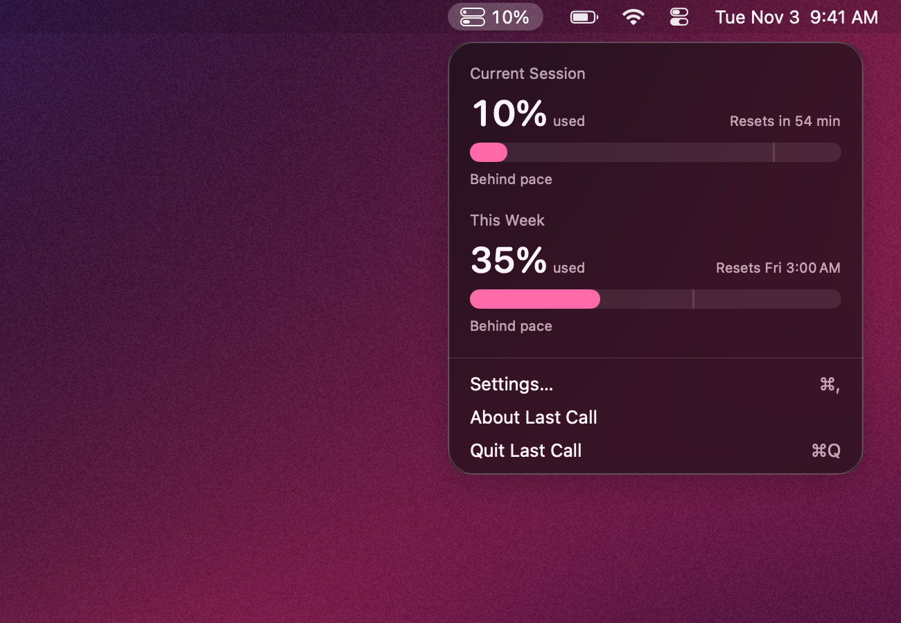

# Last Call

Last Call is a macOS menu bar app that shows your Claude 5-hour session usage and weekly usage as percentages, with the time each one resets.

<p align="center"></p>

## What it shows

- Menu bar: an icon of two stacked bars (5-hour on top, weekly below), each filled to its utilization, plus text set in Settings: session percentage, weekly percentage, both (`42% · 18%`), or icon only.
- Popover, opened by clicking the menu bar item:
  - Current Session: percent used, a bar, and “Resets in 2 hr 13 min”.
  - This Week: percent used, a bar, and “Resets Thu 9:00 AM”.
  - Opus This Week and Sonnet This Week, when Claude reports those windows.
  - A tick on each bar marks how much of the window has elapsed. The caption reads “Ahead of pace” when usage is more than 5 points above that mark, “Behind pace” when more than 5 points below, and “On pace” otherwise.
  - Bars are the accent color, orange at 80% and above, red at 95% and above.
  - Settings… (⌘,), About Last Call, Quit Last Call (⌘Q).
- If Claude can’t be reached, the last numbers stay on screen dimmed, with a line saying what failed and when the next try is, and “Updated 12 min ago” showing their age.

## Settings

- Open at Login.
- Menu Bar Shows: Session Percentage, Weekly Percentage, Both, or Icon Only.
- Notifications, each sent once per window: session reaches 80%, session reaches 95%, session resets (only if it was at 80% or more), weekly limit reaches 80%.

## Shortcuts app

“Get Claude Usage” returns text such as `Session 42%, resets 3:40 PM. Week 18%, resets Thu 9:00 AM.`

## Where the numbers come from

Last Call reads the Claude Code sign-in from the login Keychain (item “Claude Code-credentials”) by running `/usr/bin/security`, then requests `https://api.anthropic.com/api/oauth/usage` with that access token. When the token is within 5 minutes of expiring, Last Call refreshes it at `https://platform.claude.com/v1/oauth/token` and writes the new tokens back to the same Keychain item, so Claude Code stays signed in. Nothing is sent anywhere else, and tokens are never logged or shown.

It polls every 5 minutes (plus or minus 15 seconds), when the popover opens and the data is more than 60 seconds old, and after the Mac wakes. After an HTTP 429 the interval doubles, up to 30 minutes. While signed out it checks the Keychain every 60 seconds.

## Setup

Sign in to Claude Code once. In Terminal:

```
claude /login
```

If Last Call finds no sign-in, the popover shows “Sign in to Claude Code to see your limits.” with a Copy Sign-In Command button that puts `claude /login` on the pasteboard.

## Build

Requires macOS 26 and Xcode 26 or later.

```
Scripts/build-app.sh
```

This builds `dist/LastCall.app` and signs it ad hoc. `Build Last Call.command` does the same when double-clicked in Finder, then opens the app.

```
swift build
swift test
```

## Layout

- `Sources/LastCallKit`: credentials, token refresh, usage client, models, pace math, formatting, notification rules.
- `Sources/LastCallApp`: menu bar item, popover, Settings, About, notifications, App Intent.
- `Tests/LastCallKitTests`: JSON decoding, pace math, countdown formatting, token expiry, refresh flow, notification rules.

## License

Copyright © 2026 Daniel McCullum. Last Call is free software under the [GNU General Public License v3.0](LICENSE): you may use, change and share it, and anything you distribute that's built from it must be shared under the same license.
